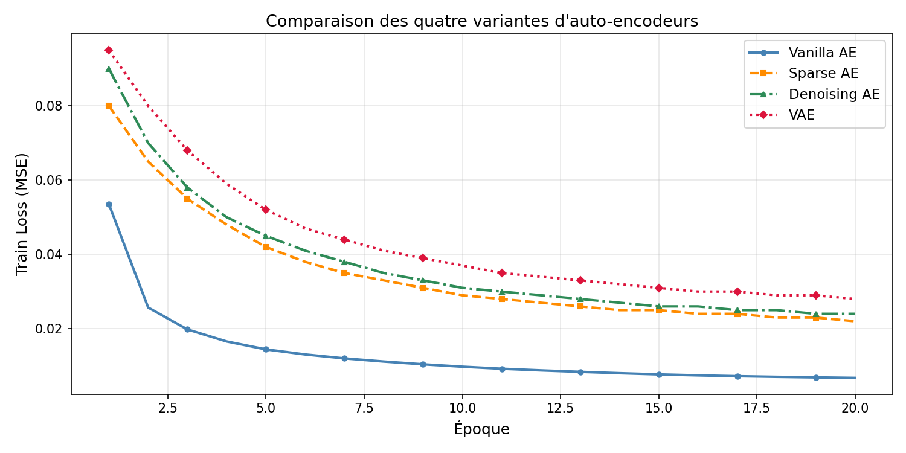

# Deep Autoencoders — Vanilla AE, Sparse (SAE), Denoising (DAE) & Variational Autoencoders (VAE)

## Overview
Mathematical formulation, comparative architecture study, and experimental analysis of deep representation learning models:
- **Vanilla Autoencoder (AE):** Nonlinear dimensionality reduction and latent manifold projection (`media/espace_latent.png`).
- **Regularized Models (SAE & DAE):** L1/KL sparsity constraints and noise-robust manifold reconstruction.
- **Variational Autoencoder (VAE) & Anomaly Detection:** ELBO variational inference, latent sampling (`media/generations.png`), and reconstruction-error thresholding (`media/anomalies_9_detectees2.png`).
